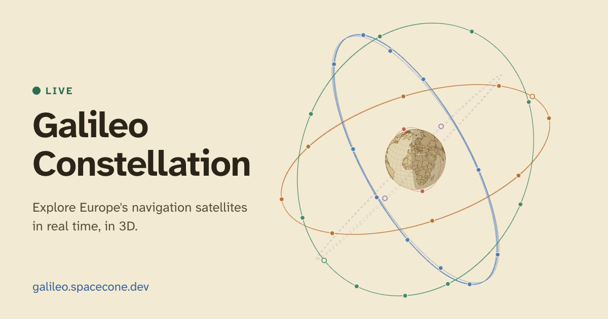

# Galileo & LEO-PNT Globe

**Live: https://galileo.spacecone.dev**



An interactive 3D globe showing the Galileo and LEO-PNT (ESA Celeste) satellites in real time,
built with React, D3 and Vite. Spin and zoom the globe (drag and scroll, or drag and pinch on a
phone), click a satellite for its position and status, or click the Earth to see which satellites
are above the horizon from that spot.

Orbits are propagated in the browser with satellite.js from TLEs published by
[CelesTrak](https://celestrak.org); per-satellite service status comes from the
[European GNSS Service Centre](https://www.gsc-europa.eu/system-service-status/constellation-information).

## Getting started

```bash
npm install
npm run dev
```

## Scripts

| Command | What it does |
| --- | --- |
| `npm run dev` | Refreshes the data (falls back to existing files on failure), then starts Vite |
| `npm run build` | Typechecks, then builds into `dist/` |
| `npm run preview` | Serves the production build locally |
| `npm run typecheck` | Runs the TypeScript compiler without emitting |
| `npm run lint` | Runs ESLint |
| `npm test` | Runs the Vitest unit tests |
| `npm run data:refresh` | Downloads TLEs and status into `public/data/` (`-- --force` ignores the 1-hour cache) |

## Data

The app reads static files from `public/data/` rather than calling CelesTrak or the GSC from
the browser. The files are committed to the repo, and a scheduled GitHub Actions workflow
(`.github/workflows/refresh-data.yml`) refreshes them every 6 hours and pushes any change.
CelesTrak refuses downloads from Cloudflare's build servers, which is why the build does not
fetch them itself. See `scripts/refresh-data.js` for the validation it applies; a failed
download keeps the previous file.

## Deployment

The site is a static build served by a Cloudflare Worker named `galileo` (static assets),
connected to this repo, with `galileo.spacecone.dev` as its custom domain. Cloudflare builds and
deploys on every push to `main`, including the data refresh commits.

| Setting | Value |
| --- | --- |
| Build command | `npm run build` |
| Deploy command | `npx wrangler deploy --assets=dist --name=galileo --compatibility-date=2026-10-01` |

`.github/workflows/ci.yml` runs lint, typecheck, tests and a build on pull requests.

## Credits

Orbital elements: [CelesTrak](https://celestrak.org). Service status: European GNSS Service
Centre (GSC). Country outlines: [world-atlas](https://github.com/topojson/world-atlas).
